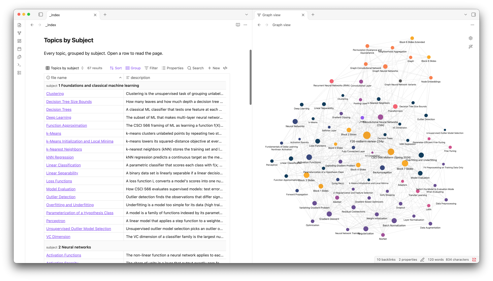

# CSCI 566 Midterm Wiki

<picture>
  <source media="(prefers-color-scheme: dark)" srcset="resources/example-dark.png">
  
</picture>

A study wiki for the midterm of CSCI 566, Deep Learning and its Applications, at USC in Fall 2026. Every page is written from the course's own slides and cites the deck and page it came from.

## What Is Inside

- **All seven testable blocks.** The lecture decks for Blocks 1 to 7, with Block 6 in both its original and extended form. That is eight PDFs and 2,088 pages of slides.
- **The midterm review slides.** The instructor's 234-page walk through the seven blocks, with worked examples and check questions.
- **A sample midterm.** The Spring 2024 exam with its answer key, mapped question by question onto the topics so the most examined ideas are easy to find.

The slides and the exam are in `attachments/`. The pages that explain them are in `wiki/`, and `_index.md` lists every topic by subject.

## How to Open It

The repository is an [Obsidian](https://obsidian.md) vault. Clone it, then in Obsidian choose **Open folder as vault** and pick the repository folder. Start at `_index.md`. No plugins need to be installed; the index table and the graph colours use features that ship with Obsidian.
