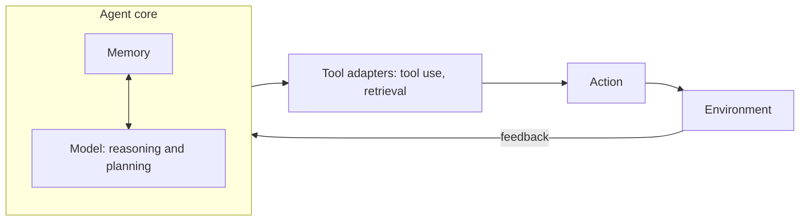
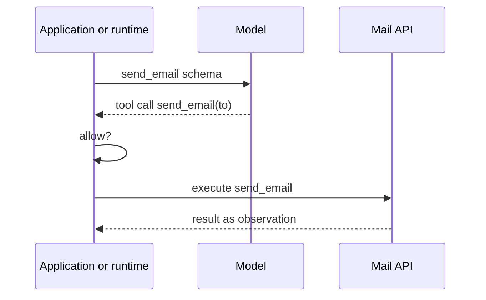

> [!concept] Concept
> 3 sources · refreshed 2026-10-13 · #machine-learning/cs566-deeplearning
> Up: [[Large Language Models]]

## Definition

"An agent is a model choosing tools in a loop" ([[Block 1 Slides]], p. 88, definition adapted from LangChain documentation). An LLM alone takes text in, gives text out, and stops. An agent calls tools and gets each result back as an observation.

[[Block 2 Slides]] states the loop as steps: pick a model, expose a tool, call it, check the result, repeat (p. 212).

The slides label tools by risk: `search_papers` and `read_paper` only read; `send_email` has a side effect ([[Block 1 Slides]], p. 88).

## Explanation

### The loop

A hosted agent system (the lecture's term) repeats one cycle. The agent core plans, tool adapters act on the environment, and feedback changes the next plan (Lecture 1, § The Agent Loop; [[Block 1 Slides]], p. 90). The summary: "Core plans; adapters act; feedback starts the next turn."

- **Agent core**: memory and the model (reasoning and planning), which interact in both directions. The notes call it "Song's diagram". The slide names the source: Dawn Song, UC Berkeley "Agentic AI", Fall 2025 (p. 90).
- **Tool adapters**: tool use and retrieval. They connect the core to the environment.

### A tool call is a request

The model does not run tools. It returns a request, and the runtime decides whether to execute it (Lecture 1, § A Tool Call Is a Request; [[Block 1 Slides]], p. 89, citing Anthropic tool-use docs):

1. The application or runtime sends the model the `send_email` schema.
2. The model returns a call such as `{name: send_email, to: ...}`.
3. The runtime checks whether to allow the call.
4. The runtime executes `send_email` against the Mail API.
5. The result returns to the runtime as an observation.

"The model proposes; the runtime executes."

Synthesis: step 3 is where a deployed system can limit what the model does. A side-effect tool such as `send_email` is where this check matters most.

### Classical ML in the control plane

The control plane of the loop is usually not another large model. Classification, nearest neighbors, trees, and thresholds decide which model runs and what it may do ([[Block 2 Slides]], p. 212).

- **Model routing** is cost-sensitive classification. A false negative costs quality. A false positive costs money. "The threshold is the design." Routers use the classical algorithms of Week 2. A 2026 study picked XGBoost (p. 212).
- **CARROT** is a router that uses kNN classification and kNN regression over cost (p. 212).
- **Tool selection** is top-k retrieval (p. 212). It is not solved: on the ToolRet benchmark of 43,000 tools, every retriever scored below 35% Completeness@10 (p. 212).

Synthesis: routing and tool selection happen before step 1 of the tool call above. They decide which model gets the request and which tool schemas it sees.

### What goes wrong in deployment

The case study on [[Deployment Failure Modes]] adds two points:

- Excess privilege starts before step 3. The agent can choose a broader skill or tool than the task needs, and the call can still pass the check. "Least privilege is the narrowest sufficient authority, not the shortest plan" ([[Block 1 Slides]], p. 139). The skill layer sits between user intent and tool execution, and it is a privilege boundary (pp. 142–143). See [[FORTIS]].
- A loop can repeat the same refused step until it hits the turn cap. In the slides' example, a false refusal at step 3 leads to retries of the same state until the turn cap at 10 (p. 125). Depth counts action turns, and a timeout means the run reached its cap with no final answer (p. 129).

The feedback step is what [[ReAct]] uses to correct a plan.

## Related

- [[ReAct]]: the reasoning pattern that runs inside this loop
- [[Tree of Thoughts]]: search over reasoning steps, and the 2026 test-time reasoning controls
- [[Agent Skills]]: packaged procedures that choose tools and can pre-approve them
- [[Agent Memory]]: the memory half of the agent core
- [[Deployment Failure Modes]]
- [[FORTIS]]
- [[Autoregressive Language Modeling]]: the model inside the core
- [[Machine Learning Task Types]]: the agent-system level of the task, experience, and performance table

## Sources

- Lecture 1, § The Agent Loop and § A Tool Call Is a Request
- [[Block 1 Slides]], pp. 88–90, 125, 129, 139, 142–143
- [[Block 2 Slides]], p. 212
