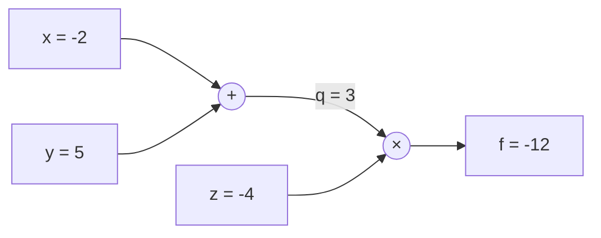

> [!concept] Concept
> 4 sources · refreshed 2026-10-13 · #machine-learning/cs566-deeplearning
> Up: [[Backpropagation]]

## Definition

A computational graph splits a calculation, such as a loss, into small operations. Each operation is a node: add, multiply, max, and so on. Each edge carries a value from one node to the next.

The user's account of the Sep 14 lecture: gradients are difficult to calculate by hand, but "we can make this map representation so we can see the calculations the machine is doing" (Sep 14 Lecture Account, § Computational graphs). The slides call "computational graphs + backpropagation" the "better idea" than deriving gradients on paper ([[Block 3 Slides]], pp. 104-105). Their first graph computes a linear score $f = Wx$, a hinge loss, and a regularization term $R(W)$, and adds them to get $L$ (p. 105, credited to Stanford CS231n).

## Explanation

### Forward and backward pass

- **Forward pass:** compute the value of each node in order, from the inputs to the output.
- **Backward pass:** start at the output and move back through the graph. At each node, multiply the gradient that arrives from above (the upstream gradient) by the node's local derivative (the local gradient). Send the result to the node's inputs ([[Block 3 Slides]], pp. 128-133).

The backward pass is the chain rule, applied one node at a time:

$$\frac{\partial f}{\partial x} = \frac{\partial f}{\partial q} \cdot \frac{\partial q}{\partial x}$$

### Worked example

Let $f = (x + y) \cdot z$ with $x = -2$, $y = 5$, $z = -4$. Name the middle value $q = x + y$, with $\partial q / \partial x = \partial q / \partial y = 1$ ([[Block 3 Slides]], pp. 108-133, credited to CS231n).

Forward pass: $q = -2 + 5 = 3$, then $f = 3 \cdot (-4) = -12$ (p. 110).

Backward pass:

| Step | Node and input | Local derivative | Upstream × local |
| --- | --- | --- | --- |
| 1 | output | none | $\partial f / \partial f = 1$ |
| 2 | multiply, to $z$ | $\partial f / \partial z = q = 3$ | $1 \cdot 3 = 3$ |
| 3 | multiply, to $q$ | $\partial f / \partial q = z = -4$ | $1 \cdot (-4) = -4$ |
| 4 | add, to $x$ | $\partial q / \partial x = 1$ | $-4 \cdot 1 = -4$ |
| 5 | add, to $y$ | $\partial q / \partial y = 1$ | $-4 \cdot 1 = -4$ |

Check by hand: $\partial f / \partial x = z = -4$ and $\partial f / \partial z = x + y = 3$.

Two rules follow from the example:

- An add node sends the upstream gradient unchanged to each input.
- A multiply node sends each input the upstream gradient times the other input.

The copy and max gates, a sigmoid-neuron example, and the vector case are on [[Backpropagation]].

### Vectorized example

[[Block 4 Slides]] recaps the graph with vectors: $f(x, W) = \lVert W \cdot x \rVert^2 = \sum_{i=1}^{n} (W \cdot x)_i^2$ (p. 10). The graph has two nodes: a multiply node for $q = W \cdot x$, then an L2 node for $f$.

| Value | Forward | Gradient (backward) |
| --- | --- | --- |
| $W$ | $\begin{pmatrix} 0.4 & 0.6 \\ 0.7 & -0.2 \end{pmatrix}$ | $\begin{pmatrix} 0.38 & 0.1228 \\ 0.29 & 0.174 \end{pmatrix}$ as printed |
| $x$ | $(0.5, 0.3)$ | $(0.71, 0.34)$ |
| $q = W \cdot x$ | $(0.38, 0.29)$ | $(0.76, 0.58)$ |
| $f$ | $0.2285$ | $1$ |

Source: [[Block 4 Slides]], p. 10.

Synthesis: the L2 node has the local gradient $\partial f / \partial q = 2q$, which gives $(0.76, 0.58)$. The multiply node then gives $\partial f / \partial W = 2q\, x^T$ and $\partial f / \partial x = W^T (2q)$. These formulas reproduce every number on the slide except one: the top-right entry of the gradient for $W$ is $0.76 \times 0.3 = 0.228$, not the printed 0.1228.

### Small graphs

The slides draw three short functions as graphs ([[Block 3 Slides]], pp. 158-160): the L2 loss $(x - y)^2$ as a subtract node and a square node; the sigmoid $1/(1 + e^{-x})$ as a chain of negate, exp, add, and divide nodes; and ReLU $\max(x, 0)$ as one max node. "Computational graph representation may not be unique. Choose one where local gradients at each node can be easily expressed!" (p. 150).

### Autograd

General background, not from a course source: automatic differentiation (autograd) builds the graph while the code runs. Each operation stores the rule for its local derivative. After the forward pass, one call runs the backward pass, for example `loss.backward()` in PyTorch. The programmer writes only the forward calculation.

### Why it matters

The numerical gradient changes one weight by a small $h$ and computes the loss again, once for each weight ([[Block 1 Slides]], pp. 320-334; see [[Gradient Descent]]). One backward pass through the graph gives the gradient for every weight. [[Gradient Descent]] then uses that gradient in the update.

Synthesis: the backward pass multiplies local derivatives along each path. Many factors below 1 give a very small gradient in the early layers. This links the graph to the [[Vanishing Gradient Problem]].

Open question: which framework does the assignment use for autograd?

## Related

- [[Backpropagation]]: the chain rule on graphs, gate patterns, vectors, and a full network
- [[Forward Propagation]]
- [[Gradient Descent]]
- [[Activation Functions]]: ReLU, sigmoid, and tanh are nodes with their own local derivatives
- [[Loss Functions]]: the output node of a training graph
- [[Vanishing Gradient Problem]]
- [[Optimization]]

## Sources

- [[Block 3 Slides]], pp. 104-133, 150, 158-160
- [[Block 4 Slides]], p. 10, the vectorized example
- Sep 14 Lecture Account, § Computational graphs
- [[Block 1 Slides]], pp. 320-334, for the numerical gradient
- The autograd section is general background with no course source.
