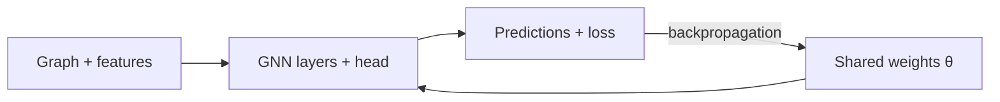

> [!concept] Concept
> 3 sources · refreshed 2026-10-19 · #machine-learning/cs566-deeplearning
> Up: [[Graph Neural Networks]]

## Definition

A graph convolutional network (GCN) is a [[Graph Neural Networks|graph neural network]] that learns how to propagate information across a graph to compute node features ([[Block 6 Slides]], p. 82; [[Block 6 Slides Extended]], p. 77). Each node's neighborhood defines a computation graph. The GCN first determines the node computation graph, then propagates and transforms information along it ([[Block 6 Slides]], p. 82; [[Block 6 Slides Extended]], p. 77). The GCN aggregates neighbors by the mean, which can be expressed in matrix form ([[Block 6 Slides]], p. 133).

## Explanation

### Motivation

A shared node MLP reorders its outputs correctly but ignores the edges. The next step is a GNN that passes and aggregates information from neighbors and stays permutation invariant or equivariant ([[Block 6 Slides]], pp. 80-81). [[Neighborhood Aggregation]] describes how each node builds its embedding from its local neighborhood.

### Update rule

The slides call the rule "The Math: Deep Encoder" ([[Block 6 Slides]], p. 89; [[Block 6 Slides Extended]], p. 84):

$$h_v^{0} = x_v$$

$$h_v^{(k+1)} = \sigma\Big(W_k \sum_{u \in N(v)} \frac{h_u^{(k)}}{|N(v)|} + B_k h_v^{(k)}\Big), \quad \forall k \in \{0, \dots, K-1\}$$

$$z_v = h_v^{(K)}$$

The Pages column cites [[Block 6 Slides]] first, then [[Block 6 Slides Extended]].

| Symbol | Meaning | Pages |
| --- | --- | --- |
| $h_v^{(k)}$ | hidden representation (embedding) of node $v$ at layer $k$ | pp. 89, 98; pp. 84, 98 |
| $x_v$ | input features of node $v$; the layer-0 embedding | p. 89; p. 84 |
| $\sum_{u \in N(v)} h_u^{(k)} / \lvert N(v) \rvert$ | average of the neighbors' previous-layer embeddings | p. 89; p. 84 |
| $W_k$ | trainable weight matrix for neighborhood aggregation | p. 98; p. 98 |
| $B_k$ | trainable weight matrix for the node's own hidden vector | p. 98; p. 98 |
| $\sigma$ | a non-linearity such as ReLU | p. 89; p. 84 |
| $K$ | total number of layers | p. 89; p. 84 |
| $z_v$ | final node embedding, after $K$ layers of neighborhood aggregation | pp. 89, 98; pp. 84, 98 |

Synthesis: a note on the slide says "summation is a permutation invariant pooling/aggregation" ([[Block 6 Slides]], p. 89; [[Block 6 Slides Extended]], p. 84), while the rule divides the sum by $|N(v)|$ to get the mean. Sum and mean are both permutation invariant. The mean also keeps the scale of the message the same for nodes of different degree.

[[Neighborhood Aggregation]] covers how far information travels as layers are added, and traces a toy version of this rule with fixed weights. The slides state that the toy rule is not the exact normalized GCN rule ([[Block 6 Slides]], pp. 90-93; [[Block 6 Slides Extended]], pp. 86-89).

### Invariance and equivariance

- Given a node, the GCN that computes its embedding is permutation invariant. The neural network weights are shared across neighbors, and the average of the neighbors' embeddings does not depend on their order ([[Block 6 Slides]], p. 94).
- Over all nodes in a graph, GCN computation is permutation equivariant: permute the input, and the output permutes the same way ([[Block 6 Slides]], pp. 95-96).

See [[Permutation Invariance and Equivariance]].

### Shared parameters

The compute graphs of different nodes use the same $W_k$ and $B_k$ at each layer ([[Block 6 Slides]], p. 105). At one GNN layer, every node uses the same learned matrices ([[Block 6 Slides Extended]], p. 107; [[F26-midterm-review-234p]], p. 213). [[Block 6 Slides Extended]] names the parts of the update that can learn (p. 90; the same slide is [[F26-midterm-review-234p]], p. 206):

| Part | What it does |
| --- | --- |
| Neighbor information | Transform or weight the messages. |
| Node information | Combine the messages with the node's current vector. |
| Shared parameters | Reuse the same update rule across nodes. |

Training learns the shared transforms from the prediction loss ([[Block 6 Slides Extended]], p. 90; [[F26-midterm-review-234p]], p. 206).

The road version of the deck names two matrices. $W_{self}$ transforms a node's own vector, and $W_{neighbor}$ transforms the neighbor mean. Each road runs the same update with different input vectors ([[Block 6 Slides Extended]], p. 107; [[F26-midterm-review-234p]], p. 213). The weights depend on the feature width, not on the road IDs ([[Block 6 Slides Extended]], p. 107; [[F26-midterm-review-234p]], p. 213). If each node vector has 2 numbers, $W_{self}$ and $W_{neighbor}$ are each 2x2. More nodes mean more uses of the same function ([[Block 6 Slides Extended]], p. 108; [[F26-midterm-review-234p]], p. 214). A new road E, with its own vector [3, 1] and neighbor vectors [1, 0] and [5, 2] (mean [3, 1]), goes through the same update. The learned matrices can process E because the vector widths match ([[Block 6 Slides Extended]], p. 109). [[Node Embeddings]] covers how this lets a trained model embed nodes it never saw.

Synthesis: $W_{self}$ has the role of $B_k$ in the update rule, and $W_{neighbor}$ has the role of $W_k$.

### Compatible inputs: feature column order

A matching width is necessary but not sufficient. A midterm review question tests this ([[F26-midterm-review-234p]], pp. 220-221). A GNN was trained with atom features [atomic number, charge]. A new molecule gives [charge, atomic number]. The model has no learned node IDs, and the edge encoding is unchanged. Before the frozen model runs, what must change? The answer is C: restore the training feature order and definitions before applying the shared weights. Then "Each column again carries the meaning that the shared weights were trained on." (p. 221). The other options fail (p. 221):

| Option | Why it fails |
| --- | --- |
| A. No change, because the width is still 2 | "The width matches, but the weights were learned for what each column means, not just the count." |
| B. Pad the node count to match the training molecules | Node count is not the issue. Shared weights work on graphs of different sizes. |
| D. Reorder the atom feature rows and leave the adjacency matrix unchanged | "This mismatches atom rows with edges and leaves the feature columns swapped." |

"Compatible features permit computation; accuracy still needs evaluation." ([[F26-midterm-review-234p]], p. 221).

Synthesis: a matching width lets the matrix products run, as for road E above. But $W_{self}$ and $W_{neighbor}$ give each input column its own weights, so a column swap feeds charge into the weights learned for atomic number. The node (row) order can change freely if the adjacency matrix moves with it ([[Permutation Invariance and Equivariance]]). The feature (column) order cannot change.

### Weight sharing across architectures

CNNs, RNNs, and GNNs reuse one set of weights many times, so the extra uses do not add parameters ([[F26-midterm-review-234p]], p. 233):

| Architecture | What is shared |
| --- | --- |
| CNN | the same kernel at every spatial position ([[Convolutional Layer]]) |
| RNN | the same update at every time step ([[Recurrent Neural Networks (RNN)]]) |
| GNN | the same update at every node |

"A larger compatible input repeats the rule with no new parameters." The slide adds: "Parameters are fixed at inference; attention weights depend on input." ([[F26-midterm-review-234p]], p. 233).

### Training

To train the GCN, define a loss function on the embeddings ([[Block 6 Slides]], p. 97; [[Block 6 Slides Extended]], p. 97). Feed the embeddings $z_v$ into any loss function, and run SGD to train the weight parameters ([[Block 6 Slides]], p. 98; [[Block 6 Slides Extended]], p. 98). A node embedding is a function of the input graph ([[Block 6 Slides]], p. 99; [[Block 6 Slides Extended]], p. 100).

A complete training step ([[Block 6 Slides Extended]], p. 102):

"Connections define the computation; labels tell us how to score it." Backpropagation updates the shared model parameters ([[Block 6 Slides Extended]], p. 102). For node A, a shared classifier head converts $h_A$ into class scores, and a training label supplies the loss for a labeled node. The head and the GNN layers train together when both are trainable ([[Block 6 Slides Extended]], p. 99; [[F26-midterm-review-234p]], p. 212). See Head (machine learning).

- **Supervised:** minimize $\mathcal{L}(y, f_\Theta(z_v))$, where $y$ is the node label. Use L2 if $y$ is a real number, or cross-entropy if $y$ is categorical ([[Block 6 Slides]], p. 99; [[Block 6 Slides Extended]], p. 100; see [[Loss Functions]]). Supervised training trains the model directly for a task such as node classification. Example: classify a drug node in a drug-drug interaction network as safe or toxic ([[Block 6 Slides]], p. 100; [[Block 6 Slides Extended]], p. 101). For binary node classification, use the cross-entropy loss ([[Block 6 Slides]], p. 101; [[Block 6 Slides Extended]], p. 103):

$$\mathcal{L} = -\sum_{v \in V} \Big[ y_v \log \sigma(z_v^\top \theta) + (1 - y_v) \log\big(1 - \sigma(z_v^\top \theta)\big) \Big]$$

  Here $z_v$ is the encoder output, $\theta$ holds the classification weights, and $y_v$ is the node class label ([[Block 6 Slides]], p. 101; [[Block 6 Slides Extended]], p. 103).
- **Unsupervised:** no node label exists, so the graph structure is the supervision ([[Block 6 Slides]], p. 99; [[Block 6 Slides Extended]], p. 100).

### Model design in four steps

1. Define a neighborhood aggregation function ([[Block 6 Slides]], p. 102; [[Block 6 Slides Extended]], p. 104).
2. Define a loss function on the embeddings ([[Block 6 Slides]], p. 102; [[Block 6 Slides Extended]], p. 104).
3. Train on a set of nodes, which is a batch of compute graphs ([[Block 6 Slides]], p. 103; [[Block 6 Slides Extended]], p. 105).
4. Generate embeddings for nodes as needed, also for nodes the model never trained on ([[Block 6 Slides]], p. 104; [[Block 6 Slides Extended]], p. 106).

## Related

- [[Graph Neural Networks]]
- [[Neighborhood Aggregation]]: the computation graph, depth, and synchronous updates
- [[Permutation Invariance and Equivariance]]
- [[Node Embeddings]]: shallow encoders, and embeddings for unseen nodes
- Road Delay GNN Example: the road graph behind $W_{self}$ and $W_{neighbor}$
- Head (machine learning): the shared classifier on each node vector
- [[Convolutional Layer]]: the grid version, with a separate weight for each spatial offset
- [[Recurrent Neural Networks (RNN)]]: the same weights reused at every time step
- [[Activation Functions]]: $\sigma$, for example ReLU
- [[Loss Functions]]
- [[Gradient Descent]]
- [[Backpropagation]]

## Sources

- [[Block 6 Slides]], pp. 80-105, 133
- [[Block 6 Slides Extended]], pp. 77, 84, 86-90, 97-109
- [[F26-midterm-review-234p]], pp. 206, 212-214, 220-221, 233
