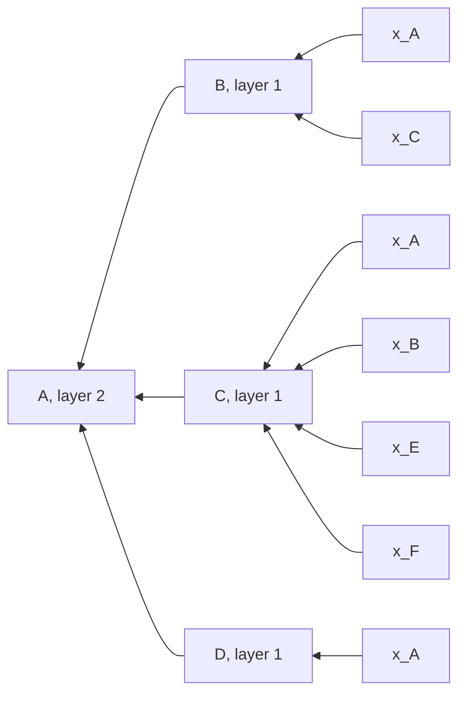
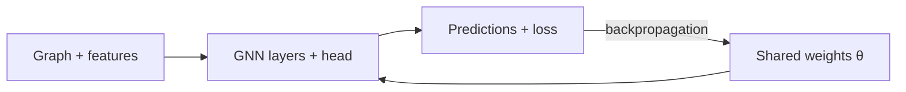

## Definition

A graph neural network (GNN) is a deep learning model for data in the form of a graph. It is a deep node encoder: "multiple layers of non-linear transformations based on graph structure" ([[Block 6 Slides]], p. 56). Each layer updates every node's embedding from the embeddings of its neighbors and its own, with one set of weights shared by all nodes ([[Block 6 Slides]], p. 133; [[Block 6 Slides Extended]], p. 61). The midterm review sums it up in one line: "Graph networks update node features using edges, then read out predictions per node or per graph." ([[F26-midterm-review-234p]], p. 197).

The basic GNN of the course, which aggregates neighbors by their mean, is the graph convolutional network (GCN) ([[Block 6 Slides]], p. 133). GNN approaches differ mainly in what goes in the aggregation box ([[Block 6 Slides]], p. 87).

A bare page number on this page refers to [[Block 6 Slides]].

## Explanation

### Graphs as Data

A graph has nodes (vertices, the set $V$) and edges (links, the set $E$). The slides call graphs "a general language to describe and analyze entities with relations/interactions" (p. 3), and the extended deck says a graph "describes which objects can exchange information" ([[Block 6 Slides Extended]], p. 5). The GNN part of the slides uses this notation (p. 63):

- $V$ is the vertex set, and $v \in V$ is a node.
- $A$ is the adjacency matrix, assumed binary.
- $X \in \mathbb{R}^{|V| \times m}$ holds one $m$-dimensional feature row per node.
- $N(v)$ is the set of neighbors of $v$.

A feature is "an observed value we give the model before it predicts" ([[Block 6 Slides Extended]], p. 15). The feature describes the node, and the edge describes its connection (p. 18). If a dataset has no node features, use a one-hot indicator for each node or a vector of constant 1s (p. 63). Choosing the nodes, edges, and features is the graph representation, and "the way you assign links will determine the nature of the question you can study" (p. 14). The node type and edge meaning belong to the representation ([[Block 6 Slides Extended]], p. 19).

Kinds of graph (pp. 12-16):

| Kind | Definition | Example |
| --- | --- | --- |
| Undirected | links are symmetrical and reciprocal | collaboration, friendship |
| Directed | each link has a direction | citations, phone calls |
| Bipartite | nodes split into two sets $U$ and $V$, and every link joins $U$ to $V$ | authors to papers, users to movies |
| Heterogeneous | $G = (V, E, R, T)$ with node types $T(v)$ and relation types $r \in R$ on edges $(v_i, r, v_j)$ | a biomedical knowledge graph: (fulvestrant, Treats, Breast Neoplasms) |

An edge can also carry weights, properties, types, and attributes (p. 15). A self-loop and two edges between one pair of nodes are both allowed ([[Block 6 Slides Extended]], p. 22).

Graph tasks work at four levels (p. 17):

| Level | Target | Example |
| --- | --- | --- |
| Node | one node | node classification: label the unlabeled nodes of a partly labeled graph (p. 19) |
| Edge (link) | a pair of nodes | link prediction: rank the unlinked pairs and predict the top $K$ (p. 21), as in recommender systems (p. 22) |
| Community (subgraph) | a group of nodes | community detection: find densely linked clusters (p. 58) |
| Graph | the whole graph | graph-level prediction and graph generation (pp. 17, 25), as in drug discovery (pp. 26-30) |

Before GNNs, the pipeline was input graph, hand-designed structural features such as degree and centrality, a learning algorithm, and a prediction (pp. 20, 40). [[Node Embeddings]] replace the hand-designed features with learned ones (p. 41).

### Why Graphs Need Their Own Model

The deep learning toolbox is built for sequences and grids: CNNs for images, RNNs for text and speech (p. 59). Networks are harder for three reasons (p. 60; [[Block 6 Slides Extended]], p. 12):

- They have arbitrary size and complex topology, with no spatial locality as grids have.
- They have no fixed node ordering or reference point.
- They are often dynamic and have multimodal features.

A naive approach joins the adjacency matrix and the node features and feeds each row into a deep network. It fails three ways (p. 64; [[Block 6 Slides Extended]], p. 64): it needs $O(|V|)$ parameters, it does not apply to graphs of a different size, and it is sensitive to node ordering. The goal is to generalize convolution beyond simple lattices (p. 65). A graph has neighborhoods, but no fixed grid-shaped window and no sliding window, and its node numbering is arbitrary (p. 66; [[Block 6 Slides Extended]], p. 66).

The extended deck follows one road network. The task is to predict whether road A will be delayed in the next 5 minutes, from the current loads and the road connections ([[Block 6 Slides Extended]], p. 13). Road A has load 1. Alone, A sees only 1. A GNN lets A read its own input and the neighbor loads B = 2 and C = 4 ([[Block 6 Slides Extended]], p. 16). A shared node MLP applies the same function to each road's own features and ignores the edges; a GNN at A also reads the neighbors, and the mean of 2 and 4 is 3 in either listing order ([[Block 6 Slides Extended]], p. 74; [[F26-midterm-review-234p]], p. 199).

Synthesis: weight sharing alone does not make a GNN. A shared node MLP also shares its weights. The difference is that the GNN update reads the neighbors.

### The Update Rule

The key idea is to generate node embeddings from local network neighborhoods (p. 83). One update of road A runs as message passing ([[Block 6 Slides Extended]], p. 75; [[F26-midterm-review-234p]], p. 200): neighbors B and C send their vectors, A aggregates the messages, and A combines the result with its own vector to update $h_A$. The basic approach is to average the messages from the neighbors and apply a neural network (p. 88). The slides call the rule "The Math: Deep Encoder" (p. 89; [[Block 6 Slides Extended]], p. 84):

$$h_v^{(0)} = x_v$$

$$h_v^{(k+1)} = \sigma\Big(W_k \sum_{u \in N(v)} \frac{h_u^{(k)}}{|N(v)|} + B_k h_v^{(k)}\Big), \quad k \in \{0, \dots, K-1\}$$

$$z_v = h_v^{(K)}$$

| Symbol | Meaning |
| --- | --- |
| $h_v^{(k)}$ | embedding of node $v$ at layer $k$; layer 0 is the input feature $x_v$ |
| $\sum_{u \in N(v)} h_u^{(k)} / \lvert N(v) \rvert$ | mean of the neighbors' previous-layer embeddings |
| $W_k$ | trainable matrix for the neighbor mean (the extended deck's $W_{neighbor}$) |
| $B_k$ | trainable matrix for the node's own vector (the extended deck's $W_{self}$) |
| $\sigma$ | a non-linearity such as ReLU |
| $z_v$ | final embedding after $K$ layers |

The slides note that summation is a permutation-invariant aggregation (p. 89). A mean or a sum treats the neighbors as a set: A gets the same neighbor mean whether the list is B, C or C, B ([[Block 6 Slides Extended]], p. 92; [[F26-midterm-review-234p]], p. 208). Synthesis: the mean also keeps the message at the same scale for nodes of different degree.

**Computation graph.** The input graph describes the connections; the computation graph describes one update ([[Block 6 Slides Extended]], p. 76). Every node defines its own computation graph from its neighborhood (p. 85). The target node is at the top, its neighbors one level down, and their neighbors one level further; the leaves hold the layer-0 input features (p. 86; [[F26-midterm-review-234p]], p. 224). The 2-layer computation graph of node A in the slides' example (p. 86):

Synthesis: this is not the computational graph of backpropagation, where a node is one arithmetic operation. Here a node is one graph node at one layer, and each box is a learned aggregation. Backpropagation runs through the computational graph of the whole GNN computation.

**Depth and reach.** The model can have any depth, and a layer-$k$ embedding can use information from up to $k$ hops away (p. 86). Information moves one graph edge per layer ([[Block 6 Slides Extended]], p. 91; [[F26-midterm-review-234p]], p. 207). On the path V-W-X-Y-Z, information from Z reaches Y after 1 layer, X after 2, W after 3, and V after 4, assuming each layer reads only neighbors from the previous layer and there is no global shortcut ([[F26-midterm-review-234p]], p. 226). Depth is a modeling choice: one or two layers use nearby context, more layers reach distant nodes, and the cost is that node vectors may become less distinct and compute increases ([[Block 6 Slides Extended]], p. 116). Synthesis: the literature calls that loss of distinctness over-smoothing. The slides do not use the term.

**Synchronous updates.** The slides trace a toy rule with fixed weights, $h_v^{(k+1)} = 0.5\, h_v^{(k)} + 0.5 \cdot \text{mean}\{h_u^{(k)}\}$, on the path B-A-C-D, and say it is not the exact normalized GCN rule (pp. 90-93; [[F26-midterm-review-234p]], pp. 202-205). The trace shows that every new value uses only the previous layer, that two layers move information two edges, and that the schedule is read layer $k$, then write layer $k+1$. An in-place update of A before B would give $B^1 = 2$ instead of 1.5. Node numbering does not define an update schedule (p. 93). The values at layer 0 are observed inputs; after an update, the values are hidden quantities the model computes ([[F26-midterm-review-234p]], p. 201). Synthesis: an in-place schedule would make the result depend on node order, which breaks the equivariance below.

### Invariance, Equivariance, and Shared Weights

For one node, the GCN that computes its embedding is permutation invariant: the weights are shared across neighbors, and the neighbor mean does not depend on their order (p. 94). Over all nodes, the computation is permutation equivariant: permute the input, and the output permutes the same way (pp. 95-96). Following Bronstein's ICLR 2021 keynote, a GNN is a stack of permutation-equivariant layers followed by a permutation-invariant readout that gives one output for the graph (p. 78; [[Block 6 Slides Extended]], p. 115; [[F26-midterm-review-234p]], p. 218). [[Permutation Invariance and Equivariance]] works this out with matrices.

**Shared parameters.** All nodes use the same $W_k$ and $B_k$ at each layer (p. 105; [[Block 6 Slides Extended]], p. 107). The extended deck names the learnable parts of the update: transform or weight the neighbor messages, combine them with the node's own vector, and reuse the same rule across nodes ([[Block 6 Slides Extended]], p. 90; [[F26-midterm-review-234p]], p. 206). The weight shapes depend on the feature width, not on the node IDs: with 2 numbers per node, $W_{self}$ and $W_{neighbor}$ are each 2x2, and more nodes mean more uses of the same function ([[Block 6 Slides Extended]], pp. 107-108; [[F26-midterm-review-234p]], pp. 213-214). A new road E with vector [3, 1] and neighbor mean [3, 1] goes through the same update, because the widths match ([[Block 6 Slides Extended]], p. 109).

CNNs, RNNs, and GNNs all reuse one set of weights, so a larger input adds no parameters ([[F26-midterm-review-234p]], p. 233):

| Architecture | What is shared |
| --- | --- |
| CNN | the same kernel at every spatial position ([[Convolutional Layer]]) |
| RNN | the same update at every time step ([[Recurrent Neural Networks (RNN)]]) |
| GNN | the same update at every node |

"Parameters are fixed at inference; attention weights depend on input." ([[F26-midterm-review-234p]], p. 233).

**Inductive use.** The parameter count depends on width and depth, not on $|V|$, so a trained model embeds nodes and graphs it never saw (p. 105). Train on the protein interaction graph of organism A, then embed organism B (p. 106); train on a snapshot of Reddit or YouTube, then embed each new node as it arrives (p. 107). The review states the condition: "Shared per-node updates with a mean or sum over neighbors respect node reordering and apply to new graphs with compatible features." ([[F26-midterm-review-234p]], p. 197). In a new city, the model keeps its weights and computes vectors from the new roads and links; it "Runs without retraining, but accuracy must be evaluated; outputs are not probabilities" ([[F26-midterm-review-234p]], pp. 215, 219). "Computing an output and predicting accurately are separate checks." (p. 215).

**Feature column order.** A matching width is necessary but not sufficient. A GNN was trained with atom features [atomic number, charge]; a new molecule gives [charge, atomic number]. Before the frozen model runs, restore the training feature order, so that "Each column again carries the meaning that the shared weights were trained on." ([[F26-midterm-review-234p]], pp. 220-221). Leaving the input alone fails because "the weights were learned for what each column means, not just the count"; padding the node count fails because node count is not the issue; reordering the feature rows without the adjacency "mismatches atom rows with edges and leaves the feature columns swapped" (p. 221). Synthesis: the node (row) order can change freely if the adjacency moves with it. The feature (column) order cannot.

### Output Level and the Prediction Head

A GNN is the middle stage of a pipeline: graph and node features go in, the GNN gives node embeddings, and a prediction head turns the embeddings into task outputs ([[Block 6 Slides Extended]], p. 48). The GNN itself outputs a matrix $H$ with one row $h_u$ per node; with $k$ layers, each row holds information out to $k$ hops. No step turns the output back into a graph. Synthesis: "what does a GNN output?" has two answers. The encoder outputs node vectors; the full model, encoder and head, outputs the task prediction.

The one design rule is "Choose the output before choosing the model." ([[Block 6 Slides Extended]], p. 28). The required output tells where the head attaches:

- **Node output.** Each node embedding passes through a shared head to its own label (p. 108). Reordering the node inputs reorders the node outputs, since the output rows follow the input rows ([[Block 6 Slides Extended]], p. 112; [[F26-midterm-review-234p]], p. 209). Example: the delay risk of road A.
- **Pair or edge output.** Predict whether two objects have a relationship ([[Block 6 Slides Extended]], p. 28), for example a drug-protein interaction (p. 46). Synthesis: one choice of head scores two node vectors with the dot product $h_u^\top h_v$, read as the probability of an edge, which is the decoder of the shallow encoders in [[Node Embeddings]] (p. 49).
- **Whole-graph output.** A readout pools the node embeddings with sum or mean into one graph label (p. 109). A symmetric readout gives the same output after reordering ([[Block 6 Slides Extended]], p. 113). Example: a molecule property from pooled atom vectors (p. 46).

Node tasks keep one output per node; graph tasks pool the node vectors; the task decides which ([[Block 6 Slides Extended]], p. 114; [[F26-midterm-review-234p]], p. 217). "Our GNN head must match the scientific question." ([[Block 6 Slides Extended]], p. 45).

Synthesis: a GNN does not, in general, predict the future state of a graph. Link prediction changes the graph one pair at a time, and the road forecast is a node-level prediction of a future value. Graph generation is a separate graph-level task.

### Training

A GNN is one choice of $f_\Theta$ in the usual objective $\min_\Theta \mathcal{L}(y, f_\Theta(x))$, trained with minibatches, backpropagation, and SGD (p. 61; see [[Gradient Descent]] and [[Backpropagation]]). Define a loss on the embeddings $z_v$, feed them into any loss function, and run SGD on the weights (pp. 97-98). A node embedding is a function of the input graph (p. 99). The head and the GNN layers train together when both are trainable ([[Block 6 Slides Extended]], p. 99): "Connections define the computation; labels tell us how to score it." (p. 102).

- **Supervised.** Minimize $\mathcal{L}(y, f_\Theta(z_v))$ with $y$ the node label: L2 if $y$ is real, cross-entropy if categorical (p. 99; see [[Loss Functions]]). Example: classify a drug node in a drug-drug interaction network as safe or toxic (p. 100). For binary node classification (p. 101):

$$\mathcal{L} = -\sum_{v \in V} \Big[ y_v \log \sigma(z_v^\top \theta) + (1 - y_v) \log\big(1 - \sigma(z_v^\top \theta)\big) \Big]$$

  Here $\theta$ holds the classification weights and $y_v$ is the label (p. 101).
- **Unsupervised.** "No node label available. Use the graph structure as the supervision!" (p. 99). The graph autoencoder below is the worked form.

Model design in four steps (pp. 102-104): define a neighborhood aggregation function, define a loss on the embeddings, train on a set of nodes (a batch of compute graphs), and generate embeddings for nodes as needed, also for nodes the model never trained on.

### CNN as a Special GNN

Each architecture shares parameters over a structure: a CNN over spatial offsets, an RNN over the previous state, a GNN over graph neighbors ([[Block 5 Slides]], p. 4). A CNN layer with a 3x3 filter updates pixel $v$ from itself and its 8 neighbors, with one weight matrix per position (pp. 111-112):

$$h_v^{(l+1)} = \sigma\Big(\sum_{u \in N(v)} W_l^u h_u^{(l)} + B_l h_v^{(l)}\Big)$$

The GNN update uses one $W_l$ for all neighbors (p. 112). A CNN can learn a different $W_l^u$ per neighbor because it can order the 9 pixels by their offset from the center, from $(-1,-1)$ to $(1,1)$ (p. 113). So a CNN is a special GNN with a fixed neighbor size and ordering and a predefined filter size, while a GNN handles arbitrary graphs in which each node can have a different degree (p. 114). Arbitrary pixel permutations do not preserve the fixed offsets of a CNN (p. 114). A CNN encoder reuses learned filters at many pixels and on new images; a GNN encoder reuses learned update weights at many nodes and on new graphs. In both, the new inputs must have the expected feature meanings and widths ([[Block 6 Slides Extended]], p. 111). See [[Convolutional Neural Networks (CNN)]].

### Variants

The decks cover these three unevenly. Edge direction appears as a property of the data and in the causal attention mask. Attention appears as a weighted sum over tokens, with one bridge slide to GNNs. The decks never name the graph attention network or the graph autoencoder. Everything beyond the slides is marked as synthesis.

**Directed edges.** The decks define directed graphs as data (p. 15) and never say what the update does with a direction. The one directional construction they show is the causal mask: "The causal mask makes the allowed interactions directional" (p. 118). Synthesis: a directed edge $u \to v$ splits the neighborhood of $v$ into in-neighbors and out-neighbors, and the common choices are:

1. Treat the graph as undirected: symmetrize $A \leftarrow \max(A, A^\top)$ and run the baseline rule. Direction is lost, which is fine when it is uninformative.
2. One weight matrix per direction: aggregate in-neighbors with $W_k^{in}$ and out-neighbors with $W_k^{out}$, then add both to the self term. The model can learn that a citation received and a citation given mean different things.
3. More flexible weights: one matrix $W_k^r$ per relation type $r \in R$, which takes the heterogeneous graph of p. 12 into the update (the relational GCN of Schlichtkrull et al. 2018). Edge features or weights can scale each message.

Reading in-neighbors only, along the edge direction, is a natural default for a flow or citation graph. Discarding the in-edges to keep only the out-neighbors is not a standard method; the sample exam uses it as a distractor.

**Attention-weighted aggregation.** Attention is "a weighted sum of the values, dependent on the query" (p. 116). The bridge slide says a road GNN and self-attention both restrict information flow, and the difference is the weighting: "Attention learns input-dependent mixing weights" ([[Block 6 Slides Extended]], p. 121). "Projection parameters are learned and fixed at inference; attention weights are recomputed for each input" ([[F26-midterm-review-234p]], p. 182). Synthesis: the graph attention network (GAT, Veličković et al. 2018) replaces the uniform $1/|N(v)|$ with a learned weight per pair:

$$e_{vu} = \text{LeakyReLU}\left(a^\top [W h_v \,\|\, W h_u]\right), \qquad \alpha_{vu} = \frac{\exp(e_{vu})}{\sum_{w \in N(v)} \exp(e_{vw})}, \qquad h_v' = \sigma\left(\sum_{u \in N(v)} \alpha_{vu} W h_u\right)$$

The score depends only on the two embeddings, the softmax normalizes over the neighbors of $v$, and several heads run in parallel as in a Transformer. A distance-based weighting is the same design with a fixed score such as $-\lVert h_v - h_u \rVert^2$ or $h_v^\top h_u$ in place of the learned $a$.

Synthesis: this keeps permutation invariance under two conditions. The score must depend on the pair of embeddings (or the pair plus edge features), never on the neighbor's position in the list; a weight that goes to "the first neighbor" breaks invariance the way the slot weights on p. 79 do. And the combination after weighting must be symmetric: a sum, mean, or max, not a concatenation or a recurrent pass. A weight $\alpha_{vu}$ that is a function of the pair travels with its neighbor, so the terms swap places inside a sum that does not care about order, and the softmax denominator is a sum over the same set. The choice of distance does not threaten invariance; a score or combiner that reads the order does.

**Graph autoencoder.** The decks supply both halves without the name. The encoder-decoder framework of [[Node Embeddings]] maps each node to $z_v$ and decodes with the dot product $z_v^\top z_u$, which should approximate the similarity of $u$ and $v$ in the network, in the simplest case whether they are linked (pp. 46, 49, 54). It is "unsupervised/self-supervised": no labels, task independent (p. 55). The deep encoders "can be combined with node similarity functions defined earlier" (p. 56), and the unsupervised training setting uses "the graph structure as the supervision" (p. 99). The deck shows no unsupervised example. Synthesis: the graph autoencoder (GAE, Kipf and Welling 2016) is exactly that combination. The encoder is a GCN, $Z = \text{GCN}(X, A)$, so it uses node features and shares weights, unlike the shallow lookup. The decoder reconstructs the adjacency:

$$\hat{A} = \sigma(Z Z^\top), \qquad \hat{A}_{uv} = \sigma(z_u^\top z_v)$$

The loss is binary cross-entropy between $\hat{A}$ and $A$ over node pairs, with the missing edges down-weighted or sampled because most pairs of a sparse graph are not linked. The variational form (VGAE) puts a Gaussian over $Z$ and adds a KL term. The embeddings serve link prediction directly, since $\hat{A}_{uv}$ scores an unseen pair, and node classification or clustering after the fact. A GAE is a variant by training objective, not by architecture: the same GCN layers run inside it, and what changes is the decoder and the loss.

## Related

- [[Permutation Invariance and Equivariance]]: the road-delay example as matrices, and the slot-weight counterexample
- [[Node Embeddings]]: the shallow encoders that GNNs replace, and the dot-product decoder the GAE reuses
- [[Convolutional Neural Networks (CNN)]]: the special GNN on a grid
- [[Convolutional Layer]]: one weight per spatial offset
- [[Pooling Layer]]: aggregation over a grid window; the graph readout is its graph form
- [[Recurrent Neural Networks (RNN)]]: the same weights at every time step
- [[Transformers]]: attention as input-dependent mixing weights
- [[Activation Functions]]: $\sigma$, for example ReLU
- [[Loss Functions]]: cross-entropy on labels, or on the adjacency in a GAE
- [[Gradient Descent]]
- [[Backpropagation]]
- Road Delay GNN Example: the toy values layer by layer and on an unseen graph

## Sources

- [[Block 6 Slides]], pp. 3-30, 40-66, 78-118, 133: graphs as data, task levels, the naive approach, the update rule, invariance, training, the CNN comparison, attention
- [[Block 6 Slides Extended]], pp. 5-28, 45-48, 61-66, 74-76, 90-92, 99-121: the road example, nodes, edges, and features, message passing, the prediction head, shared weights, depth, and the attention bridge
- [[Block 5 Slides]], p. 4: parameter sharing across architectures
- [[F26-midterm-review-234p]], pp. 182, 197-226, 233: the midterm review of GNNs, inductive use, feature order, k-hop reach, and weight sharing
- [[CSCI 566 Midterm (Spring 2024)]], Q16, Q17, Q48
