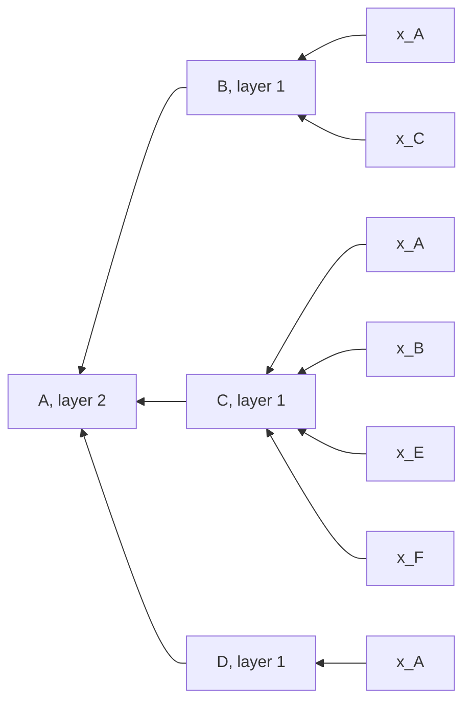

> [!concept] Concept
> 3 sources · refreshed 2026-10-19 · #machine-learning/cs566-deeplearning
> Up: [[Graph Neural Networks]]

## Definition

Neighborhood aggregation is the step in which a node combines information from its neighbors to compute its next embedding. The key idea is to generate node embeddings from local network neighborhoods ([[Block 6 Slides]], p. 83; [[Block 6 Slides Extended]], p. 78; [[F26-midterm-review-234p]], p. 223). Nodes aggregate information from their neighbors with neural networks ([[Block 6 Slides]], p. 84; [[Block 6 Slides Extended]], p. 79). Different approaches differ mainly in how they aggregate information across the layers. The slides ask: "What is in the box?" ([[Block 6 Slides]], p. 87; [[Block 6 Slides Extended]], p. 82).

## Explanation

### Messages

[[Block 6 Slides Extended]] (p. 75) and [[F26-midterm-review-234p]] (p. 200) describe one update of road A as message passing:

1. Neighbors B and C send their vectors.
2. A aggregates the neighbor messages.
3. A combines the result with its own vector and updates $h_A$.

Each node combines its own information with the information of its neighbors ([[Block 6 Slides Extended]], p. 75; [[F26-midterm-review-234p]], p. 200).

### The computation graph of a node

The input graph describes the connections. The computation graph describes one update ([[Block 6 Slides Extended]], p. 76). In a computation graph, a repeated label is the same node at a different layer ([[Block 6 Slides Extended]], p. 76). Every node defines its own computation graph based on its neighborhood ([[Block 6 Slides]], p. 85; [[Block 6 Slides Extended]], p. 80). The target node is at the top. Its neighbors are one level down, and their neighbors are one level further down ([[Block 6 Slides]], pp. 82, 86; [[Block 6 Slides Extended]], pp. 77, 81; [[F26-midterm-review-234p]], pp. 223-224). The leaves hold the layer-0 embeddings, which are the input features $x$ ([[Block 6 Slides]], p. 86; [[Block 6 Slides Extended]], p. 81; [[F26-midterm-review-234p]], p. 224).

The 2-layer computation graph of target node A in the slides' example graph ([[Block 6 Slides]], p. 86; [[Block 6 Slides Extended]], p. 81; [[F26-midterm-review-234p]], p. 224):

Synthesis: this is not the same thing as a computational graph in backpropagation. There, a node is one arithmetic operation, and the graph carries values forward and gradients backward. Here, a node is the embedding of one graph node at one layer, and each box is a learned aggregation. The two meet in training: backpropagation runs through the computational graph of the whole GNN computation.

### The basic approach

(1) Average the messages from the neighbors. (2) Apply a neural network ([[Block 6 Slides]], p. 88; [[Block 6 Slides Extended]], p. 83; [[F26-midterm-review-234p]], p. 225). [[Graph Convolutional Network]] writes this as the update rule $h_v^{(k+1)} = \sigma\big(W_k \sum_{u \in N(v)} h_u^{(k)} / |N(v)| + B_k h_v^{(k)}\big)$ ([[Block 6 Slides]], p. 89; [[Block 6 Slides Extended]], p. 84). Summation is a permutation-invariant pooling or aggregation ([[Block 6 Slides]], p. 89; [[Block 6 Slides Extended]], p. 84), so the result does not depend on the order of the neighbors. A mean or a sum treats the neighbors as a set: A gets the same neighbor mean whether the list is B, C or C, B ([[Block 6 Slides Extended]], p. 92; [[F26-midterm-review-234p]], p. 208). See [[Permutation Invariance and Equivariance]].

### Depth and receptive field

The model can have any depth. Each node has an embedding at each layer. The layer-0 embedding of node $v$ is its input feature $x_v$, and a layer-$k$ embedding can use information from up to $k$ hops away ([[Block 6 Slides]], p. 86; [[Block 6 Slides Extended]], p. 81; [[F26-midterm-review-234p]], p. 224). Information moves one graph edge per local aggregation layer ([[Block 6 Slides Extended]], p. 91; [[F26-midterm-review-234p]], p. 207). On the path graph B-A-C-D, layer 1 at A reads B and C. At layer 2, D can contribute to A through C ([[Block 6 Slides Extended]], p. 91; [[F26-midterm-review-234p]], p. 207). Depth expands the neighborhood that can influence a node ([[Block 6 Slides Extended]], p. 91; [[F26-midterm-review-234p]], p. 207).

The midterm review traces the reach on a longer path, V-W-X-Y-Z. With one-hop layers, information moves one edge per layer. Information from Z reaches Y after 1 layer, X after 2, W after 3, and V after 4. This reach assumes that each layer reads only neighbors from the previous layer, with no global shortcut ([[F26-midterm-review-234p]], p. 226). Synthesis: on such a model, a node $d$ edges away cannot influence a node before layer $d$.

[[Block 6 Slides Extended]] calls the number of layers a modeling choice. A larger neighborhood can help, but it can also dilute differences (p. 116):

| Depth | Effect |
| --- | --- |
| One or two layers | Use nearby graph context. |
| More layers | Reach more distant nodes and reuse transformed signals. |
| Possible cost | Node vectors may become less distinct, and compute increases. |

Choose the depth from the task and the validation results ([[Block 6 Slides Extended]], p. 116).

Synthesis: the GNN literature calls the loss of distinct node vectors at large depth "over-smoothing". The slides do not use this term.

### Synchronous updates

The slides trace a toy rule with fixed weights on the path graph B-A-C-D. They state that it is not the exact normalized GCN rule ([[Block 6 Slides]], pp. 90-93; [[Block 6 Slides Extended]], pp. 86-89; [[F26-midterm-review-234p]], pp. 202-205):

$$h_v^{(k+1)} = 0.5\, h_v^{(k)} + 0.5 \cdot \text{mean}\{h_u^{(k)} : u \text{ is a neighbor of } v\}$$

Road Delay GNN Example holds the values layer by layer. The trace shows three rules:

- Every new value uses only the previous layer ([[Block 6 Slides]], p. 91; [[Block 6 Slides Extended]], p. 87; [[F26-midterm-review-234p]], p. 203).
- Two layers let information travel two graph edges ([[Block 6 Slides]], p. 92; [[Block 6 Slides Extended]], p. 88; [[F26-midterm-review-234p]], p. 204).
- Read layer $k$, then write layer $k+1$. An in-place update of A before B would give $B^1 = 2$ instead of 1.5. Node numbering does not define an update schedule ([[Block 6 Slides]], p. 93; [[Block 6 Slides Extended]], p. 89; [[F26-midterm-review-234p]], p. 205).

Synthesis: an in-place schedule would make the result depend on the node order, which breaks the permutation equivariance that a GNN needs.

## Related

- [[Graph Neural Networks]]
- [[Graph Convolutional Network]]: the update rule, the shared parameters, and training on batches of compute graphs
- [[Permutation Invariance and Equivariance]]
- Road Delay GNN Example: the toy values layer by layer
- Computational Graphs: the backpropagation graph, a different idea
- [[Graph]]
- [[Pooling Layer]]: aggregation over a grid window in a CNN

## Sources

- [[Block 6 Slides]], pp. 82-93
- [[Block 6 Slides Extended]], pp. 75-89, 91-92, 116
- [[F26-midterm-review-234p]], pp. 200, 202-205, 207-208, 223-226: the midterm review of message passing, synchronous updates, and depth
